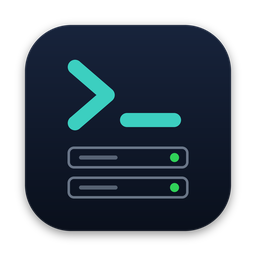
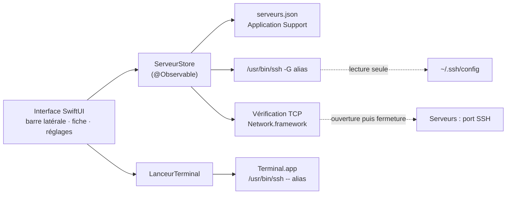

<p align="center">
  
</p>

<h1 align="center">NOYA SSH Manager</h1>

<p align="center">
  Gestionnaire de connexions SSH <strong>natif pour macOS</strong> — léger, local, sécurisé et entièrement en français.
</p>

<p align="center">
  <a href="https://github.com/elit28/NOYA-SSH-MANAGER/releases/latest"></a>
  <a href="https://github.com/elit28/NOYA-SSH-MANAGER/actions/workflows/ci.yml"></a>
  
  <a href="LICENSE"></a>
</p>

NOYA SSH Manager est écrit en Swift et SwiftUI, sans aucune dépendance externe. Il ne remplace pas OpenSSH : il organise vos serveurs, surveille leur disponibilité et ouvre vos sessions dans Terminal avec le client `/usr/bin/ssh` de macOS, en respectant votre fichier `~/.ssh/config`.

**[Télécharger la dernière version](https://github.com/elit28/NOYA-SSH-MANAGER/releases/latest)** · [Installation](#installation) · [Premiers pas](#premiers-pas) · [Sécurité](#sécurité-et-confidentialité) · [Contribuer](CONTRIBUTING.md)

> **Préversion 0.2.0.** La section [État des vérifications](#état-des-vérifications) indique précisément ce qui a été testé, et où.

## Fonctionnalités

- **Liste de serveurs** organisée par groupe, avec recherche instantanée (nom, alias, hôte, utilisateur, groupe), sans tenir compte des accents ni de la casse.
- **Environnements** clairement identifiés : Production, Test, Ancien serveur.
- **Import depuis `~/.ssh/config`** : les sections `Host` (et les fichiers `Include`) sont lues pour proposer vos alias existants.
- **Connexion en un clic** (⌘↩) dans une nouvelle fenêtre Terminal, avec `/usr/bin/ssh -- alias`.
- **Paramètres effectifs** de chaque alias (hôte, utilisateur, port, clé, rebond) calculés par OpenSSH lui-même avec `ssh -G`.
- **Surveillance de disponibilité** : test TCP du port SSH, en parallèle, avec latence, délai d'expiration de 3 s et actualisation toutes les 30 s **uniquement quand la fenêtre est au premier plan**.
- **Import / export JSON** de la liste (sans aucun secret).
- **Assistant IA local** (macOS 27) : raccourci ⌥⌘A vers `fm chat`, le modèle d'Apple exécuté sur le Mac, pour expliquer une commande ou un message d'erreur SSH. Voir [Assistant IA local](#assistant-ia-local-macos-27).
- Interface sombre bleu nuit, SF Symbols, raccourcis clavier macOS, animations désactivables.

## Sécurité et confidentialité

| Garantie | Mise en œuvre |
|---|---|
| Aucun mot de passe, aucune clé privée stockés | La liste ne contient que nom, alias, groupe, environnement et notes. |
| `~/.ssh/config` jamais modifié | Lecture seule ; paramètres calculés par `ssh -G`, qui ne se connecte pas. |
| Aucune option SSH ajoutée | `StrictHostKeyChecking`, l'authentification et les empreintes restent gérés par OpenSSH selon votre configuration. |
| Pas d'injection de commande | Alias validés par liste blanche (`A-Z a-z 0-9 . _ -`, pas de `-` initial), séparés par `--`, cités pour le shell. |
| Aucune commande distante | Seule action réseau automatique : ouvrir puis fermer une connexion TCP vers le port SSH. |
| Aucune télémétrie, aucun compte | Aucune donnée n'est envoyée à un service tiers. |
| Aucun processus en arrière-plan | L'application se ferme avec sa dernière fenêtre ; la surveillance s'arrête avec elle. |
| Assistant IA sans envoi de données | `fm chat` est ouvert avec le modèle d'Apple exécuté sur le Mac, jamais Private Cloud Compute ; l'application ne lit pas les conversations. |

La liste est enregistrée dans `~/Library/Application Support/NOYA SSH Manager/serveurs.json` (droits `0600`).

## Installation

1. Téléchargez la dernière archive depuis [GitHub Releases](https://github.com/elit28/NOYA-SSH-MANAGER/releases).
2. Vérifiez son intégrité : `shasum -a 256 -c NOYA-SSH-Manager-*.zip.sha256`.
3. Décompressez-la et placez **NOYA SSH Manager** dans le dossier Applications.

Les préversions publiées ne sont **ni signées avec un certificat Developer ID, ni notarisées** (voir [Distribution](#distribution-signature-et-notarisation)). Au premier lancement, macOS les bloque : ouvrez **Réglages Système › Confidentialité et sécurité** et cliquez sur **Ouvrir quand même**.

Configuration requise : **macOS 14 Sonoma** ou plus récent, Mac Apple Silicon ou Intel.

## Premiers pas

Au premier lancement, la liste est vide :

- **Importer depuis `~/.ssh/config`** (⇧⌘I) : cochez les hôtes à ajouter, choisissez un groupe et un environnement.
- **Ajouter un serveur** (⌘N) : indiquez un nom et l'alias défini dans une section `Host` de `~/.ssh/config`. L'application affiche aussitôt l'hôte, l'utilisateur et le port détectés.
- **Importer une liste** (menu Fichier) : un fichier JSON au format ci-dessous.

```json
{
  "version": 1,
  "serveurs": [
    { "nom": "Serveur web", "alias": "web-prod", "groupe": "Client A", "environnement": "production" },
    { "nom": "Ancien serveur", "alias": "ancien-serveur", "groupe": "Archives", "environnement": "ancien" }
  ]
}
```

Seul `alias` est obligatoire. `environnement` accepte `production`, `test` ou `ancien`. Exemple complet : [docs/exemple-serveurs.json](docs/exemple-serveurs.json).

## Raccourcis clavier

| Raccourci | Action |
|---|---|
| ⌘↩ | Se connecter au serveur sélectionné |
| ⌘R | Actualiser la disponibilité |
| ⌘N | Ajouter un serveur |
| ⇧⌘I | Importer depuis `~/.ssh/config` |
| ⌘E | Modifier le serveur |
| ⌘⌫ ou ⌫ | Supprimer le serveur (avec confirmation) |
| ⌘F | Rechercher (Échap pour effacer) |
| ⇧⌘C | Copier la commande SSH |
| ⌘1 … ⌘9 | Sélectionner un serveur |
| ⌃⌘S | Afficher ou masquer la barre latérale |
| ⌥⌘A | Ouvrir l'assistant IA local (macOS 27) |
| ⌘, | Réglages |

## Surveillance : ce qu'elle mesure, et ce qu'elle ne mesure pas

- **« Accessible »** signifie qu'une connexion TCP vers le port SSH a été établie. **Cela ne garantit pas que la connexion SSH réussira** : la clé, l'utilisateur et l'empreinte du serveur ne sont vérifiés qu'au moment de se connecter.
- La **latence** affichée est le temps d'établissement de la connexion TCP.
- Les alias qui passent par un **rebond** (`ProxyJump`, `ProxyCommand`) sont marqués « Non vérifiable » : un test direct ne serait pas représentatif.
- Chaque vérification apparaît dans les journaux SSH du serveur. Un pare-feu strict (par exemple **fail2ban en mode agressif**) peut juger ces connexions suspectes : augmentez l'intervalle dans **Réglages › Surveillance** si nécessaire.

## Assistant IA local (macOS 27)

macOS 27 inclut `fm`, l'outil en ligne de commande des modèles d'Apple ([WWDC26, session 334](https://developer.apple.com/videos/play/wwdc2026/334/)). NOYA SSH Manager y donne accès en un geste : bouton ✨ de la barre d'outils, menu **Assistant** ou ⌥⌘A.

- L'application ouvre `fm chat` dans une nouvelle fenêtre Terminal, avec des consignes : répondre en français, expliquer les commandes Linux et SSH et les messages d'erreur, ne jamais demander de mot de passe ni de clé, signaler les commandes risquées.
- **Modèle exécuté sur le Mac uniquement** : `--model system` est ajouté lorsque `fm chat` le prend en charge, ce qui l'emporte sur un éventuel fournisseur par défaut configuré avec `fm config`. Le modèle Private Cloud Compute n'est jamais choisi par l'application.
- **Première utilisation** : Apple demande d'accepter ses conditions une seule fois, avec un mot de passe administrateur. L'application ne lance jamais `sudo` : elle affiche la commande `sudo fm license` et propose de la copier.
- Avant l'ouverture, un court diagnostic (`fm license --status`, `fm available`, `fm chat --help`) signale un modèle pas encore téléchargé ou indisponible.
- Avant macOS 27, le bouton est masqué et le menu désactivé.

Limites connues : macOS 27 sur Mac Apple Silicon uniquement ; fenêtre de contexte limitée (environ 4 000 jetons selon les tests publiés) ; prise en charge du français non documentée par Apple ; `fm` enregistre les conversations dans `~/.fm/sessions`.

## Compilation depuis les sources

Prérequis : **Xcode 16** ou plus récent (le projet utilise les dossiers synchronisés d'Xcode 16 ; compilation vérifiée avec Xcode 26.6), macOS 14 ou plus récent.

```bash
git clone https://github.com/elit28/NOYA-SSH-MANAGER.git
```

```bash
cd NOYA-SSH-MANAGER && open NoyaSSHManager.xcodeproj
```

Ou en ligne de commande, pour produire `dist/NOYA-SSH-Manager-<version>.zip` :

```bash
./scripts/compiler.sh
```

Tests du cœur logique (macOS ou Linux) :

```bash
swift test --package-path NoyaCore
```

## Architecture



| Dossier | Contenu |
|---|---|
| `NoyaCore/` | Paquet Swift sans interface (Foundation uniquement, Swift 6 strict) : modèle, validation des alias, lecture de `~/.ssh/config`, analyse de `ssh -G`, stockage, recherche. Testé sous macOS et Linux. |
| `NoyaSSHManager/` | Application SwiftUI : vues, `ServeurStore`, vérification TCP (`NWConnection`), ouverture de Terminal. |
| `scripts/` | Compilation reproductible, notarisation, génération de l'icône. |

**Ouverture de Terminal.** L'application écrit un court script `.command` (droits `0700`, dossier temporaire privé de l'utilisateur), l'ouvre avec Terminal.app, puis le script se supprime et exécute `exec /usr/bin/ssh -- alias`. Cette méthode n'utilise pas AppleScript : macOS ne demande donc pas l'autorisation « Automatisation ».

**Pourquoi pas de sandbox ni de Mac App Store ?** Le sandbox macOS empêcherait de lancer `/usr/bin/ssh -G` avec accès à `~/.ssh/config` et d'ouvrir un script dans Terminal ; les exceptions nécessaires ne sont pas acceptées sur le Mac App Store. L'application est donc distribuée directement, avec le **Hardened Runtime** activé.

## Distribution, signature et notarisation

| Étape | État |
|---|---|
| Compilation reproductible (`scripts/compiler.sh`) | En place |
| Publication automatique sur GitHub Releases | En place (`.github/workflows/publication.yml`) |
| Signature Developer ID | **Non réalisée** : nécessite un compte Apple Developer payant |
| Notarisation Apple | **Non réalisée** : script prêt (`scripts/notariser.sh`) |

Pour signer et notariser une version :

```bash
IDENTITE_SIGNATURE="Developer ID Application: Nom (EQUIPE1234)" EQUIPE_DEVELOPPEUR="EQUIPE1234" PROFIL_NOTARISATION="noya-notarisation" ./scripts/notariser.sh
```

## Versionnage

Le projet suit le [versionnage sémantique](https://semver.org/lang/fr/). La version se trouve dans `MARKETING_VERSION` (projet Xcode) et l'historique dans [CHANGELOG.md](CHANGELOG.md). Une publication se lance en poussant une balise `vX.Y.Z` correspondant à `MARKETING_VERSION`, ou depuis l'onglet **Actions › Publication › Run workflow** : le workflow compile l'application, crée la balise et la version sur GitHub Releases.

## État des vérifications

| Élément | Vérification | Résultat |
|---|---|---|
| Cœur `NoyaCore` (57 tests) | `swift test` sous Linux (Swift 6.4 en local, 6.2 en intégration continue) | Réussi |
| Cœur `NoyaCore` (47 tests) | `swift test` sous macOS 26.7, Swift 6.3 (GitHub Actions) | Réussi |
| Compilation de l'application | `xcodebuild` Release avec Xcode 26.6 (GitHub Actions) : binaire universel arm64 + x86_64, 4,4 Mo, Hardened Runtime, signature ad hoc | Réussi |
| Lancement de l'application | Test manuel sur un MacBook Air Apple Silicon | Réussi |
| Import depuis `~/.ssh/config` | Test manuel sur un MacBook Air Apple Silicon | Réussi |
| Connexion dans Terminal | Test manuel sur un MacBook Air Apple Silicon | Réussi |
| Surveillance TCP (disponibilité, latence) | Test manuel sur un Mac | **À confirmer** |
| Assistant IA local (`fm`, macOS 27) | Tests automatisés du script et de l'analyse des sorties (faux `fm`) ; essai réel sur un Mac sous macOS 27 | **À confirmer sur macOS 27** |
| Compilation avec Xcode 16 | — | Non testée |
| Consommation mémoire et processeur | Mesure avec les outils macOS | **À réaliser** |

Un problème ? [Ouvrez un ticket](https://github.com/elit28/NOYA-SSH-MANAGER/issues/new/choose) en précisant votre version de macOS.

## Contribuer

Les contributions sont les bienvenues : lisez d'abord le [guide de contribution](CONTRIBUTING.md). Pour signaler une faille de sécurité, suivez la [politique de sécurité](SECURITY.md).

## Licence

[MIT](LICENSE) © 2026 Eli Dino.
